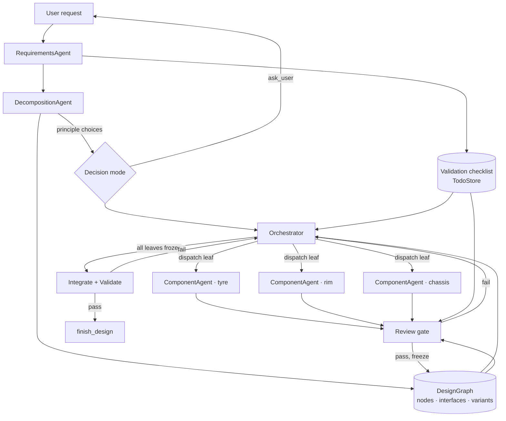
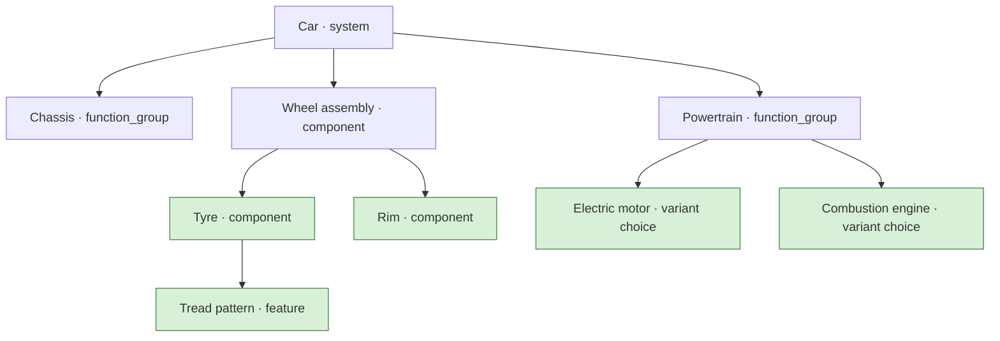

# Improved Agent Loop

## Concept for a divide-and-conquer multi-agent design topology

**Status:** Architecture concept for an **implicit-CAD** design agent (extends, does not replace, [Gladius Native Design Agent concept](./Gladius%20Native%20Design%20Agent%20concept.md))
**Target application:** Gladius native and WebAssembly builds
**Companion UI document:** [We want to redesign the Gladius Design Agent](./We%20want%20to%20redesign%20the%20Gladius%20Design%20A.md)

---

## 1. Executive summary

**Idea:** we want specialized agents for each subtask to keep context and reasoning focused, rather than having a single monolithic agent handle all tasks.

The current design agent is one `AgentLoop` run over one conversation. Every responsibility shares the same system prompt, the same tool list, and the same history: requirements gathering, functional decomposition, variant generation, snippet writing, rendering reviews, and final validation. As soon as the object has several parts, the single context becomes the bottleneck — the model spends its reasoning on bookkeeping instead of on geometry, and long runs drift into truncated or empty turns.

The improved loop applies **divide and conquer at the agent level**:

1. A **requirements agent** turns the user request into structured requirements plus a *validation checklist* that every later gate consumes.
2. A **decomposition agent** builds the design structure recursively — car → wheels → tyre + rim — and decides when to stop splitting.
3. Each decomposition step attaches **interface contracts and compatibility requirements** to its children, so independently designed components provably fit together.
4. Where several solution principles are viable (combustion vs electric drive), **decision mode** puts the choice in the design tree and asks the user.
5. A **component agent** designs one leaf at a time, seeing only that subtree, its interfaces, and its checklist entries.
6. An **orchestrator** owns the queue: it dispatches work, reviews each delivered component against the checklist, schedules redesigns, and may revise requirements at any level.

Because Gladius models are *implicit* — one signed distance field sampled by a single root function — divide and
conquer has a second effect: each leaf can be evaluated in its own isolated document instead of sharing one global
field with everything else. That is what makes a small component context physically verifiable rather than merely
convenient (§3, §10).

> **Complexity rule:** every agent gets exactly one question to answer, and a context small enough to answer it.

Everything else is inherited from the existing architecture: `DesignGraph` stays the single source of truth, the LLM proposes and orchestrates while Gladius calculates and validates, the Cartesian product of variants is never instantiated, and alternatives are evaluated at the cheapest fidelity that answers the current question.

---

## 2. Motivation

Measured behaviour of the single-agent loop (see [docs/design-agent-benchmark.md](../docs/design-agent-benchmark.md)):

- Even for single-object tasks (sphere, gyroid sphere, 3×4 LEGO brick) a run needs 7–10 model turns and 20 000–48 000 prompt tokens; the growing tool block is re-prefilled on every turn.
- Turns that return neither text nor tool calls ("silent stops") ended user runs after a few productive steps. The empty-completion guard in [AgentLoop.cpp](../gladius/src/agent/AgentLoop.cpp) makes the failure explicit and bounded, but it does not remove the underlying cause: an overloaded context.
- Validation for interactive sessions is a budgeted `capture_viewport` review plus the `finish_design` ceremony. There is no checklist, so nothing determines *which* evidence is required for *this* design; the vision judge only exists in the benchmark harness.
- One mutable conversation means one design path. Alternative principles are represented in the graph but explored in one context that keeps growing with each rejected branch.

Dividing the problem across agents fixes the same three things:

| Problem | Divide-and-conquer answer |
| --- | --- |
| Context growth and prompt-cache tax | Small per-role prompts, scoped snapshots, short conversations per agent |
| Unfocused reasoning | One responsibility per agent, one question per run |
| Weak validation | A checklist produced once, consumed by every gate, plus orchestrator review |

---

## 3. Governing principles

Carried over unchanged from the existing concept documents:

1. **The LLM proposes and orchestrates; Gladius calculates and validates.** Deterministic facts (`RenderabilityFacts`, `ManufacturingValidator`, geometry gates) are never mixed with model opinion.
2. **No parallel state model.** Requirements, nodes, variants, interfaces, configurations, todos, and knowledge live in `DesignGraph` and `TodoStore`. Agents exchange work through those structures, not through prose hand-offs or a new "subagent state" type.
3. **The Cartesian product of all variants must not be instantiated.** Branching stays symbolic until a decision is made.
4. **Cheapest fidelity that answers the current question.** Symbolic/envelope for decomposition and compatibility, structural/detailed only for the leaf being developed.
5. **The absence of further tool calls does not mean the design is complete.** Completion stays an explicit ceremony (`finish_design`), and in a multi-agent loop it is additionally gated by the orchestrator.
6. **Raw LLM reasoning is not validation output** and is not shown as such in the UI.

Implicit-CAD constraints that follow from the Gladius model itself, and that shape every role boundary below:

7. **One global field, one root.** A model is a 3MF Implicit Extension function graph whose visible surface comes
   only from `main_3(pos) -> (color, shape)` wired through `LevelSet` → `DomainMesh` → `BuildItem`
   (`ensure_output_chain`). `shape < 0` is solid interior, `shape = 0` is the surface. A component that is not
   reachable from `main_3` renders nothing, no matter how correct its snippet is — this is the failure mode the
   renderability gate already reports (`RenderabilityFacts::blockersAsText()`).
8. **Splitting is modularity, not speed.** `GraphFlattener::flatten()` inlines every call site into one flat
   WGSL/OpenCL expression, so shader cost is `flat_node_count × (march_steps + ~83)` per hit pixel at full
   quality. Calling a wheel function four times quadruples its ops; decomposition buys reuse and reviewability,
   and the price is paid in the flattened op count. `GraphFlattener::calculateExpectedNodeCount()` gives that
   number deterministically without mutating the assembly, so it is a gate rather than an opinion (§6, §8).
9. **A snippet cannot repeat itself.** The snippet language has no loops, no recursion, and no `vec3` locals —
   repetition exists only as domain symmetry (`abs(pos.x)`, `mod`) or field modulation. A periodic pattern (TPMS
   gyroid, tread ribs, a stud array) is therefore **one** implicit function, never N child nodes; splitting it
   would multiply flattened ops and produce an assembly nobody can integrate (§7).
10. **Components cannot coexist in one document.** `ResourceId`s live in one `Assembly` and only what `main_3`
    samples is visible, so a leaf is developed in its own scratch `Document`, validated standalone, and merged
    into the master document on freeze (`Document::mergeAndResolve`, the mechanism `import_library_item` already
    uses). Integration then authors `main_3` to compose the frozen leaf functions with explicit transforms, CSG
    semantics and domain bounds (§10).

---

## 4. Agent roles

Five roles. All are the same `AgentLoop` execution engine with different prompts, tool surfaces, scoped snapshots, budgets, and traces.

| Role | Question it answers | Output written to shared state |
| --- | --- | --- |
| `RequirementsAgent` | What must this design satisfy? | `DesignGraph` requirements + checklist todos, goal string |
| `DecompositionAgent` | How is the problem split, and into what interfaces? | Node subtree, `Interface` specifications, compatibility rules, todo per child |
| `DecisionAgent` *(optional, mostly deterministic)* | Which solution principles are worth keeping? | Proposed variants at `Symbolic` fidelity, rejected variants with reasons, decision prompts for the user |
| `ComponentAgent` | How is this one leaf built and does it satisfy its checklist? | Snippet/variant resource, evaluations, component agent's final report |
| `Orchestrator` | What runs next, and is delivered work acceptable? | Dispatch decisions, todo state changes, redesign and requirement-revision requests |

The orchestrator is deliberately **not** a general-purpose conversational agent. Its decision surface is small: read queue state, run deterministic gates, compare checklist verdicts, pick the next job or issue one of a bounded set of actions (dispatch, redesign, revise requirement, ask user, complete). Most of its work is plain C++; an LLM turn is used only where judgement is genuinely required.



---

## 5. Phase pipeline

The mandated UI vocabulary (Understand → Decompose → Explore → Develop → Validate) and the existing `DesignPhase` enum are kept as-is. Roles map onto them; no new phase enum is introduced.

| UI phase | `DesignPhase` values | Role(s) | Exit criterion |
| --- | --- | --- | --- |
| Understand | `ClarifyRequirements` | `RequirementsAgent` | Checklist complete, mandatory requirements have acceptance criteria, unanswered questions resolved by decision mode |
| Decompose | `DecomposeFunctions` | `DecompositionAgent` | Every leaf satisfies the stop criterion (§7), interfaces defined for every parent/child boundary |
| Explore | `GenerateSolutionPrinciples`, `BuildSystemConcepts`, `EvaluateConcepts` | `DecisionAgent`, `DecompositionAgent` | One active configuration per subtree, compatibility rules satisfied, decisions collected from user |
| Develop | `InstantiateEnvelopes`, `DevelopComponents`, `IntegrateSystem`, `Refine` | `ComponentAgent`, `Orchestrator` | All leaves frozen and review-passed, assembly renders |
| Validate | `Validate`, `Refine`, `Complete` | `Orchestrator`, `RequirementsAgent` (checklist re-run) | Checklist entries checked with evidence, `finish_design` succeeds |

Phase mapping matches `userPhaseOf()` in [AgentWorkflow.cpp](../gladius/src/ui/AgentWorkflow.cpp) exactly — notably
`InstantiateEnvelopes` and `Refine` belong to **Develop**, not Explore. Requirement revisions from the orchestrator
move the phase back (`Validate → Refine`) exactly as `reopenForFollowUpRequest()` does for user follow-ups.

---

## 6. Requirements and the validation checklist

The requirements agent produces two artefacts, both already modelled:

**Requirements** — `DesignGraph::addRequirement(description, category, mandatory)`, one per verifiable statement, plus `Constraint` expressions where a numeric limit exists. The agent is instructed to write testable statements ("total height ≤ 95 mm") rather than intentions ("compact").

**Checklist** — `TodoStore::TodoItem` with `ChecklistEntry` items. One todo per requirement *category*, each checklist entry being one verifiable acceptance criterion. Checklist entries carry a kind so gates know how to check them:

```json
{
  "label": "stud top face at z = 8.0 mm",
  "kind": "geometry",
  "evidence": {"gate": "axis_span_mm", "axis": "z", "expected": 8.0, "tolerance": 0.2},
  "checked": false
}
```

| `kind` | Who checks it | Evidence |
| --- | --- | --- |
| `geometry` | deterministic gate on the exported mesh (`axis_span_mm`, `volume_mm3`, `triangle_count`, `fill_fraction`) | numbers |
| `manufacturing` | `ManufacturingValidator::analyzeTriangles` | report fields |
| `renderability` | `RenderabilityFacts::isRenderable()` / `blockersAsText()` | blocker list |
| `interface` | interface contract comparison (§8) | mismatch description |
| `domain_bounds` | domain-clipping gate: measured bounds vs the evaluation box | clipped axis + margin in mm |
| `flat_node_budget` | `GraphFlattener::calculateExpectedNodeCount()` vs `maxFlatNodeCount` | flattened op count |
| `visual` | one `capture_viewport` review, or the benchmark vision judge | image + rubric verdict |
| `user` | decision mode: the user confirms in the design tree | their choice |

The checklist is the **contract for every validation step**: a component agent's run ends by reporting on its assigned entries, and the orchestrator refuses to freeze a node while an entry of its subtree is unchecked. Because checklists are todos, they are already serialized, displayed, and editable by the user — no new state type.

Deterministic vs judgement stays explicit: `checked` is only set by a gate or by a named human decision. Model opinion is written into `Evaluation::heuristicNotes` / `subjectiveNotes`, never into `checked`.

---

## 7. Recursive decomposition and the stop criterion

`DecompositionAgent` grows the graph with the existing `add_function(name, type, parentNodeId)` tool (`type` is one of `system`, `function_group`, `function`, `component`, `feature`) and recurses into children until a node qualifies as a leaf.

**A node is a leaf when all of these hold:**

1. **Single function** — it fulfils exactly one function in the tree.
2. **Modellable in one snippet** — its geometry can be written as one root-consumed snippet, or imported from the library (`list_library_items` / `import_library_item`) or a catalogue entry.
3. **Periodic integrity** — a periodic or field-modulated pattern (TPMS lattice, tread ribs, stud array) is one leaf, never a subtree: the snippet language has no loops (§3 rule 9), so repeating it as children would multiply flattened ops and break integration.
4. **Interfaces closed** — every boundary to its parent and siblings is described by an `Interface` specification with concrete values.
5. **Checklist assigned** — it owns at least one checklist entry, so "done" is defined before work starts.
6. **Op-count fits** — its expected flattened cost (`calculateExpectedNodeCount()` of its leaf function × planned call sites in `main_3`) fits its allotted `maxFlatNodeCount` budget; a leaf that cannot fit is re-decomposed or re-simplified, not shipped.
7. **Depth budget** — below `kMaxDecompositionDepth = 4` the agent must justify further splitting in writing; below `kHardDecompositionDepth = 6` splitting is refused by the tool.

The depth guard is a hard limit, not a hint: unbounded recursion is how a decomposition agent burns its whole turn budget producing nodes nobody will model. Example:



Decomposition is **not** done in one big pass. The agent decomposes one subtree per run and the orchestrator re-dispatches a subtree when its children turn out to be too coarse ("tyre" is still too big → split into tread, bead, carcass). This keeps each decomposition context as small as a component context and makes revision cheap: only the affected subtree is re-decomposed.

---

## 8. Interface contracts and compatibility requirements

Compatibility between independently designed components is expressed with existing structures, so it can be checked without instantiating geometry.

**Interface contract** — `DesignGraph::define_interface(variantId, name, kind, specification)` where `specification`
is JSON with *numeric* values. For implicit CAD a contract is not a face mate but a field-level agreement with five
parts:

```json
{
  "kind": "mount",
  "functionName": "wheelHub_7",
  "ports": { "shape": "signedDistance", "color": "optional" },
  "coordinateFrame": "wheelLocal",
  "anchorConvention": "groundSeatedZ0",
  "envelopeMm": { "min": [-12, -12, 0], "max": [12, 12, 16] },
  "signDiscipline": "negativeInside",
  "gradientBound": 1.2,
  "composition": { "mode": "smooth_union", "blendRadiusMm": 0.8 },
  "boreDiameterMm": 3.0,
  "mountCircleDiameterMm": 24.0,
  "maxHeightMm": 18.0,
  "maxFlatNodeCount": 900
}
```

| Part | What it pins down | Checked by |
| --- | --- | --- |
| Signature and ports | called function name, mm parameters, scalar `shape` (optional `color`/auxiliary field) | signature comparison |
| Frame and envelope | local origin/axes (centered vs ground-seated), `minMm`/`maxMm` bounding box | envelope containment of measured bounds |
| SDF metric | `shape < 0` inside, declared gradient/Lipschitz bound so `smin` fillets and shell offsets keep thickness honest | metric gate on the exported field/mesh |
| CSG semantics | how parent and child combine: `union` (`min`), `smooth_union` (`smin` + `k`), `difference`/clearance cutout (`max(parent, -cutout)`), `intersection`/infill (`max(hull, lattice)`) | composition-mode match at integration |
| Op-count budget | `maxFlatNodeCount` for the leaf times its planned call sites in `main_3` | `calculateExpectedNodeCount()` |

Two rules:

- Values are **declared before** the child is designed and **verified after**: an `interface` checklist entry compares the delivered component against the contract. A mismatch is a redesign request against the child, never a silent edit of the contract.
- Contracts come in *provider/consumer* pairs (`wheelHub` ↔ `axleMount`). The parent defines the requirement; the child must satisfy it. Only one side may own a given value.

**Compatibility requirements** — `DesignCatalogue::addCompatibilityRule(CompatibilityRule{conditions, compatible, rationale})`, plus `checkCompatibility(selections)` and `validateParameters()`. Rules express principle-level incompatibility ("electric motor requires battery cell", "TPU tread is incompatible with a press-fit rim") so the orchestrator can prune configurations instead of discovering conflicts at integration time.

**Deterministic boundary check** — new gate, C++ only: given two interface specifications in a configuration, compare shared keys numerically within tolerance and report mismatches. This is the piece that makes "components are compatible" a fact rather than an opinion. It belongs next to `RenderabilityFacts` / `ManufacturingValidator`, not in a prompt.

---

## 9. Solution-principle branching and decision mode

Where a node admits several solution principles, the decomposition agent proposes them as variants at `Symbolic` fidelity (`create_variant(nodeId, name, rationale, fidelity="symbolic")`). Nothing geometric is instantiated until a principle is selected — the Cartesian product stays symbolic.

Pruning order before a user is ever asked:

1. **Compatibility rules** eliminate impossible combinations (`checkCompatibility`).
2. **Catalogue fit** eliminates principles with no `CatalogueEntry` that supports required functions/processes.
3. **Cheapest fidelity check** eliminates principles whose envelope cannot satisfy the interfaces (deterministic).
4. Remaining choices are **genuinely user decisions**.

**Decision mode** turns those remaining choices into questions in the design tree. There is currently no ask-the-user tool: a text-only reply is interpreted as "done", which at `WorkAutonomously` produces nudges and then a silent completion — the exact failure the user reported. The fix is an explicit tool:

```
ask_user(question, options[], nodeId?, variantIds?, recommended?, reason)
  → { choice, customText? }
```

Mechanics:

- `ask_user` reuses the existing confirmation handshake by raising `UserDecisionRequiredEvent{requestId, prompt, tool, arguments}`; the panel renders it in the design tree under the affected node with the options as buttons.
- The callback returns the user's **selection payload**, not a bare bool, so `ConfirmationCallback` grows into a decision callback returning JSON (`ToolDefinition const&`, `json const&` → `json`). Web parks/resumes its coroutine exactly as it does today.
- The tool result is written back into the graph (active variant, rejected variants with reasons) and recorded as a `user` checklist entry check.
- At `AskAtMajorDecisions`/`AskAtEveryStep` questions block; at `WorkAutonomously` the agent proceeds with `recommended`, marks the checklist entry `checked = false` with a note "assumed", and lists all assumptions in its final report. No question may silently end a run — this replaces the heuristic "no tool calls means done".
- Question budget: a run asks at most `kMaxUserQuestions = 5`; beyond that it must commit to recommendations and report them, so an autonomous run cannot be blocked forever on preferences.

---

## 10. Component agents

Each leaf gets its own `AgentLoop::run()` with a focused context. That is where the complexity reduction actually comes from.

**Isolated scratch document.** Two components cannot be validated side by side inside one `Assembly`: only what
`main_3` samples renders (§3 rule 7), and every leaf competes for the same global field and evaluation domain. So a
component agent works in a **fresh scratch `Document`** seeded with the shipped volumetric scaffold
(`seedVolumetricTemplate`, [TemplateSeed.h](../gladius/src/design/TemplateSeed.h)) whose `main_3` wraps exactly one
leaf function. That gives the leaf its own domain box, its own renderability facts, and its own cost number:

- `capture_viewport`, `collectRenderabilityFacts`, `ManufacturingValidator` and STL export all describe *this leaf*;
- `GraphFlattener::calculateExpectedNodeCount()` measures the leaf's real flattened cost with no integration noise;
- a domain-clipped or budget-exceeding leaf fails its gates here instead of silently flattening inside the whole
  model later.

On freeze, the leaf function is merged into the master document with `Document::mergeAndResolve` — the same path
`import_library_item` already uses — and `IntegrateSystem` authors `main_3` to compose all frozen leaf functions
with explicit transforms, CSG semantics and domain bounds from their interface contracts (§8). Integration is a
deterministic authoring step, not a model guess: the composition modes are already declared in the contracts.

**Scoped snapshot.** `DesignContextSnapshot` gains a scope field (`scopeNodeId`, plus its checklist entries and interface contracts). The builder then reports only:

- goal (one line), phase;
- the subtree: node, siblings by name and interface summary, ancestors as an envelope chain;
- inherited interface contracts with values;
- assigned checklist entries and their acceptance criteria;
- reference images linked to that node;
- library/catalogue candidates for that function;
- renderability of the *subtree* only.

It must **not** report the full graph, all requirements, all variants, all todos, or unrelated knowledge. Today's live-state message serialises the whole design, which is precisely what makes the single-agent context explode.

**Tool surface.** Per-role registries are already possible: `DesignToolSurface` distinguishes `Full` from `GeometryOnly`, and `ToolRegistry` accepts any allowlist (`definitionsByMaxPolicy`). Proposed surfaces:

| Surface | Tools |
| --- | --- |
| requirements | `get_design_summary`, `add_requirement`, `create_todo_list`, `add_todo_item`, `update_todo_item`, `list_todos`, `ask_user`, `store_knowledge`, `search_knowledge` |
| decomposition | `get_design_summary`, `add_function`, `define_interface`, `create_variant`, `reject_variant`, `list_library_items`, `list_skills`, `load_skill`, `add_todo_item`, `update_todo_item`, `ask_user` |
| component | `begin_edit`, `commit_edit`, `rollback_edit`, `ensure_output_chain`, `get_program_snippet`, `set_program_snippet`, `get_model_summary`, `capture_viewport`, `import_library_item`, `list_library_items`, `create_checkpoint`, `restore_checkpoint`, `update_todo_item`, `score_component_reusability`, `add_variant_feedback` |
| review | `get_design_summary`, `capture_viewport`, `get_model_summary`, `set_component_evaluation`, `freeze_component`, `update_todo_item`, `reject_variant`, `ask_user` |

Geometry tools are the component surface's core; a decomposition agent must not be able to write snippets, and a component agent must not be able to redefine interfaces or spawn nodes. Restricting capabilities is cheaper and safer than instructing the model to behave.

**Per-role budgets.** `AgentLimits` is already per-run; scale it by role and leaf size instead of sharing one global budget:

| Role | turns | tool calls | viewport reviews | wall time |
| --- | --- | --- | --- | --- |
| requirements | 12 | 32 | 0 | 3 min |
| decomposition (one subtree) | 16 | 48 | 2 | 4 min |
| component | 24 | 96 | 6 | 6 min |
| review | 8 | 16 | 3 | 3 min |

Total cost is the sum of leaf budgets plus orchestration overhead. That is higher than one monolithic run in the worst case, and lower in practice: short conversations re-prefill less, cache hits survive (per-run prompt caching works when the prompt is run-constant, which per-role prompts are), and failed leaves cost a small budget instead of poisoning a large context.

**Reporting contract.** A component agent ends by calling `report_component(nodeId, satisfied[], unsatisfied[], evidence)` — a new tool that writes an `Evaluation` (deterministic facts vs heuristic notes kept separate) and marks its todos. Runs that end without it are treated as failed work by the orchestrator, not as success.

---

## 11. Orchestrator: review gate, redesigns, requirement revision

The orchestrator is a C++ scheduler with an LLM assist for judgement steps. It owns no geometry tools and writes only through existing graph/todo APIs.

**Review gate per delivered component**, in this order:

1. Deterministic: domain-bounds and flat-node-budget gates on the leaf's scratch document, renderability of the subtree, `ManufacturingValidator` report, geometry gates from checklist `geometry` entries, interface boundary comparison (§8).
2. Checklist: every `kind == "geometry" | manufacturing | renderability | interface` entry for that subtree must be satisfied with evidence. Model claims do not count.
3. Conditional visual review: one `capture_viewport` + a single `review` agent turn when the checklist has `visual` entries or deterministic gates disagree with the component report.
4. Verdict → `freezeNode(nodeId)` on pass; on fail, an action from the bounded set below.

**Bounded action set:**

| Action | Effect |
| --- | --- |
| `dispatch(nodeId)` | start a component agent for a leaf whose dependencies are frozen |
| `redesign(nodeId, findings)` | re-run that leaf with the findings as new context (fresh conversation, same scoped snapshot) |
| `refine_interface(nodeId, patch)` | hand an interface mismatch to the child agent; contract changes require an explicit reason record |
| `revise_requirement(requirementId, change, reason)` | update a requirement at any level via `updateRequirement`, which marks it as a pending change and moves the phase back to `Refine` |
| `re_decompose(nodeId, reason)` | drop the subtree's work state and dispatch the decomposition agent again |
| `ask_user(...)` | escalate a conflict that cannot be resolved technically |
| `complete()` | all leaves frozen, integration validated, checklist fully checked → `finish_design` |

**Requirement revision is bidirectional.** The requirements agent writes them first, but the orchestrator may revise any requirement at any level — e.g. a leaf that cannot satisfy an interface within its envelope triggers a change of the parent's allotted height rather than an impossible component. Every revision goes through `updateRequirement(..., trackUserChange = true)` so pending-change tracking and the UI "requirements changed" indicator still work, and downstream leaves whose checklists referenced the old value are re-queued.

**Termination guarantees** (answers the "infinite refinement" risk):

- per-leaf redesign budget `kMaxRedesignsPerNode = 3`, then escalate to `ask_user`;
- global improvement budget (`AgentLimits::maxModelTurns` for the orchestrator itself, plus a total-run wall-time ceiling);
- required progress: a gate must produce strictly better evidence than the previous attempt, otherwise the node is escalated rather than retried;
- one active configuration per subtree — no parallel refinement of unpicked branches.

**Dependency scheduling.** A leaf may be dispatched only when its inherited interfaces are final (parent interface defined, dependencies frozen). Leaves whose interfaces are not yet final wait. This makes "component by component" a topological order over the graph rather than an arbitrary sequence, and it is what prevents a wheel designed against a moving axle spec.

---

## 12. Concurrency and execution model

*(Stage 5 — deferred; Stages 0–4 are strictly sequential.)*

- Component agents for independent leaves run concurrently on separate worker threads; each gets its **own** `Conversation`, `ToolRegistry`, `ContextBuilder` (with its own prompt/scope), `AgentLimits`, `CancellationToken`, event queue, and `AgentTraceRecorder` — the trace recorder is documented as not thread-safe, so one per agent with distinct sink files.
- `DesignGraph` and `TodoStore` are shared. Today they are plain in-memory structures; concurrent writes require a mutex (or single-writer dispatch). Recommended: keep graph/todo mutation on the orchestrator thread — child agents propose through tool results and the orchestrator applies them. That avoids locking the whole design model and keeps the audit trail linear.
- Snippet evaluation and rendering are shared GPU resources: geometry work stays serialized (as in `Importer3mf` resource-loading serialization), only *reasoning* runs concurrently. Concurrency ceiling `kMaxConcurrentAgents = 3`.
- Cancellation, pause, and tool-budget checks already happen at tool boundaries inside `AgentLoop::run()`; a parent token is propagated to every child token so one Stop button ends the whole tree.

---

## 13. Required runtime changes

Small, additive changes to existing code — no rewrite of the loop:

| Area | Change |
| --- | --- |
| [AgentLoop.h](../gladius/src/agent/AgentLoop.h) | `ConfirmationCallback` returns a decision payload (JSON) instead of `bool`; add optional `std::string roleTag` for trace labelling. Loop mechanics unchanged, so single-agent behaviour is preserved. |
| [ContextBuilder.h](../gladius/src/agent/ContextBuilder.h) | Per-role prompt: replace the boolean `geometryToolSurface` switch with a `RolePrompt` descriptor (role instructions + which snapshot sections to include). Add `scopeNodeId` to `DesignContextSnapshot` and filter every summary section to that scope. Prompt stays run-constant per role so caching still works. |
| [DesignTools.h](../gladius/src/design/DesignTools.h) / .cpp | Named tool surfaces (requirements, decomposition, component, review); new tools `ask_user`, `set_component_evaluation`, `report_component`; depth guard in `add_function`. |
| New `design/InterfaceCompliance.h` | Deterministic interface-boundary comparison and the checklist gate evaluator. |
| New `design/CadGates.h` | Domain-clipping gate (measured bounds vs evaluation box) and flat-node-budget gate via `GraphFlattener::calculateExpectedNodeCount()`; both reuse existing `RenderabilityFacts` / `ManufacturingValidator` output instead of re-tessellating. |
| New `agent/DesignOrchestrator.h` | Scheduler, dependency order, action set, budgets. Owns child `AgentLoop` runs; consumes their events into one UI stream. |
| [AgentEvent.h](../gladius/src/agent/AgentEvent.h) | Add `SubAgentStartedEvent` / `SubAgentCompletedEvent{nodeId, role, resultSummary}` and a `role` field on `TextDeltaEvent`/tool events so the UI can attribute output. |
| [AgentPanels.cpp](../gladius/src/ui/AgentPanels.cpp) | Render decision-mode prompts in the design tree; per-node progress from todos; attribute streamed text to its role. |
| Trace | One recorder per agent; a top-level `session.jsonl` referencing child trace files. Perfetto output gains a lane per role. |

---

## 14. State reuse (no parallel model)

| Concept in this document | Existing structure |
| --- | --- |
| Requirements | `DesignGraph::addRequirement` / `Requirement`, `Constraint` |
| Validation checklist | `TodoStore::TodoItem` + `ChecklistEntry` |
| Design structure / decomposition tree | `DesignGraph` nodes (`System`, `FunctionGroup`, `Function`, `Component`, `Feature`) |
| Solution principles / alternatives | `DesignVariant` with `FidelityLevel` and `Proposed`/`Active`/`Frozen`/`Rejected` |
| Compatibility requirements | `Interface` specification JSON + `CompatibilityRule` + `checkCompatibility` |
| Selected combination | `Configuration::selectedVariants`, `activateConfiguration`, `substituteVariant`, `hybridizeConfigurations` |
| Deterministic vs model opinion | `Evaluation::deterministicPassed/deterministicWarnings` vs `heuristicNotes/subjectiveNotes` |
| Reference images | `DesignGraph::addReferenceImage` with `linkedNodeId` / `linkedVariantId` |
| Work queue and dispatch state | `TodoStore` items (status + checklist), one todo per decomposed node |
| Requirement changes | `updateRequirement(..., trackUserChange)`, `consumePendingRequirementChanges`, `reopenForFollowUpRequest` |

---

## 15. Benchmark and trace implications

The existing harness ([docs/design-agent-benchmark.md](../docs/design-agent-benchmark.md), `HeadlessAgentHost`, geometry gates, vision judge, metrics) must keep working and extend:

- **Topology switch**: bench/profile runs get `--topology single|hierarchical` so the comparison is measured, not asserted. The current single-agent baseline stays the reference.
- **New metrics** in `AgentBenchMetrics`: `subAgentRuns`, `perRoleTurns`/`perRoleTokens`, `userQuestionsAsked`/`userQuestionsAnswered`, `redesigns`, `checklistEntriesTotal`/`checkedWithEvidence`, `interfacesVerified`/`mismatches`, `peakConcurrentAgents`. Keep `emptyTurns`, `truncatedTurns`, prompt/cache tokens as hard gates.
- **Checklist gates become the task oracle**: a hierarchical run's `taskPassed` is `judge passes AND geometry gates pass AND every checklist entry satisfied with evidence`. That makes interactive sessions and benchmarks use the same definition of done, which today they do not.
- **Bench harness must answer `ask_user` deterministically**: scripted provider answers scripted decisions so runs stay reproducible; add the decision log to the trace.
- **Compare script gating**: cost regressions are expected per-token but should improve wall-time and turn counts per delivered component; report both, gate on quality metrics first.

---

## 16. UI implications

Matches the redesign document's vocabulary — nothing new at top level:

- **Understand** shows requirements and the checklist (todo items), each entry showing its `kind` and evidence state.
- **Decompose** shows the structure with per-node dispatch status from todos; a node in "waiting for interfaces" is shown as blocked, not as failed.
- **Explore** shows symbolic variants of the currently explored element plus decision-mode prompts attached to the node; unanswered decisions are an `Attention` state.
- **Develop** shows one row per leaf with its role, budget usage, review verdict, and redesign count — the user can see *why* a component was sent back.
- **Validate** lists unchecked checklist entries and their missing evidence; `finish_design` is blocked while any remains.
- Streamed text from several agents must be attributed by role (event `role` field); raw reasoning is never presented as validation output.

---

## 17. Migration path

Each stage keeps the current single-agent agent working and measurable.

**Stage 0 — concept alignment.** This document; agree roles, checklist kinds, interface schema, decision mode.

**Stage 1 — role prompts and scoped snapshots (single agent).** Add `RolePrompt` and `scopeNodeId`, run the existing one-agent loop with the component-role prompt on a single-node design. Verify prompt/cache improvements in the bench before any topology change.

**Stage 2 — checklist everywhere.** Checklist entries with kinds and evidence; deterministic gate evaluator (`InterfaceCompliance.h`); `finish_design` blocked on unchecked entries. Interactive runs gain real validation before multi-agent complexity exists.

**Stage 3 — decision mode.** `ask_user` tool plus the value-returning decision callback, rendered in the design tree. Removes the silent-completion class of failures permanently.

**Stage 4 — sequential multi-agent run.** Requirements → decomposition → one component agent at a time → orchestrator review gate, all sequential, no concurrency. Success criterion: measurable improvement on existing bench tasks plus new multi-component tasks (wheel assembly, tea-light house with parts).

**Stage 5 — concurrent leaves + pruning.** Parallel dispatch within dependency order, catalogue compatibility pruning, beam limits. Only after Stage 4 is stable and measured.

---

## 18. Risks

| Risk | Mitigation |
| --- | --- |
| Agents disagreeing forever (requirement ping-pong) | redesign budget per node, mandatory progress evidence, escalation to `ask_user` |
| Interface contracts drifting during development | single owner per value, revision requires a reason record and re-queues dependents |
| Cost blow-up from many agent contexts | per-role budgets, scoped snapshots, cheapest-fidelity rule, measured against baseline at every stage |
| Decomposition recursion without end | hard depth limit, leaf stop criterion (§7), orchestrator rejects unbounded splits |
| Checklist becomes theatre (everything "checked" by the model) | `kind`-based gate ownership: model cannot check deterministic entries |
| Concurrency corrupting shared design state | single-writer dispatch through the orchestrator, serialized geometry/GPU work |
| Asking the user too often | question budget per run, autonomous mode uses `recommended` and reports assumptions |

---

## 19. Open questions

1. Should checklist entries live on requirements (one entry per requirement) or be free-standing todos? Current proposal: free-standing todos grouped by category, referencing requirement IDs.
2. Interface tolerance ownership: per contract pair or global default per `kind`? Needs the first real multi-part design to decide.
3. Where does the orchestrator's judgement live — one LLM turn per review, or purely deterministic gates with LLM only on disagreement? Recommendation: deterministic-first, LLM-on-disagreement, revisited after Stage 2 measurements.
4. Do component agents need variant alternatives, or does alternative generation stay exclusively in Explore? Recommendation: exclusive to Explore, so component runs cannot multiply cost.
