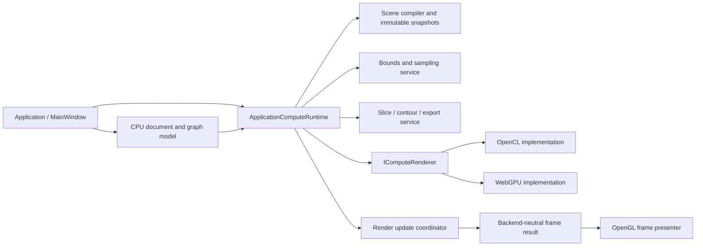

# WebGPU Compute Backend Parity Plan

## Objective and product boundary

Make Dawn/WebGPU a production compute backend for a declared, testable feature set that does not
require NanoVDB. A user selecting WebGPU must receive the same
workflow, UI state transitions, failures, and visual result as with OpenCL: model loading and
editing, interactive/progressive rendering, thumbnails, MCP rendering, and the applicable
slicing, contour, and export operations.

OpenCL remains the default until this contract is met. A partial WebGPU implementation may be
used for development and capability tests, but it must not be presented as a complete application
backend. Explicit `--compute-backend=webgpu` or `compute.backend=webgpu` must never silently run
the operation through OpenCL. Unsupported VDB/NanoVDB operations must fail with an actionable
capability diagnostic; they must not produce an empty image, a subtly different fallback, or a
successful-looking partial export. If possible non-NanoVDB alternatives should be used (e.g. bvh for mesh, distance fields for beams, and images for textures) but if the operation is not supported it must fail with a clear error message.

An intentional WebGPU selection must start a pure WebGPU application runtime. It must not be
rejected merely because `MainWindow`, `Document`, or another legacy caller still expects an
OpenCL `ComputeCore`; that dependency is an implementation gap to remove, not a valid runtime
capability failure. During development, a WebGPU build may reject a particular model or operation
that is outside its advertised profile, but the application shell, document loading/editing, graph
validation, parameter editing, capability inspection, and every operation inside the advertised
profile must remain usable without constructing OpenCL objects.

The final non-NanoVDB production profile includes every workflow named above. Capability gating is
a migration and hardware-limit mechanism, not permission to permanently omit document editing,
bounds, parameters, previews, thumbnails, MCP, slicing, contours, or export from the pure WebGPU
backend.

### Definition of parity

Parity is semantic and user-visible, not merely “the shader produced non-background pixels”. It
covers:

- identical supported graph/resource semantics and parameter values;
- identical camera, projection, clipping, flags, quality, approximation-mode, and time inputs;
- identical scheduling, cancellation, coalescing, progressive-row, resize, and stale-frame rules;
- identical output contracts, row coverage, alpha/packing, thumbnails, slices, contours, and files;
- equivalent error messages and capability reporting; and
- a documented numerical/image tolerance budget.

Cross-API bitwise identity is not a prerequisite because OpenCL, Vulkan, D3D12, and Metal may
round differently. Pixel-perfect user experience means that differences stay within a fixed,
fixture-specific budget and are not visible as geometry, lighting, banding, stale content, or
packing artifacts. The parity harness below must preserve both the raw OpenCL reference and the
diagnostic probes needed to explain any difference.

### Capability profiles

Advertise capabilities as an operation/model profile, not as one global `webgpu=true` bit.

| Profile | Must be supported before release | Explicitly unsupported until implemented |
|---|---|---|
| Analytic non-resource | graph evaluation, parameters, camera, clipping, flags, low-res, progressive, realtime, thumbnails, MCP frame rendering | none within the declared analytic node set |
| Non-NanoVDB resources | each resource type with a completed ABI and parity fixtures, such as mesh/beam/image paths | any resource whose evaluation still depends on an unimplemented VDB/NanoVDB path |
| Manufacturing | slices, contours, supported mesh/dual-contouring preparation, and export inputs | operations that require unavailable VDB/NanoVDB data |

The application must compute the profile from the loaded scene and requested operation. A model
that is outside the profile must be rejected before submission, with the missing capability and a
suggested alternative. “At least no NanoVDB” is therefore a release scope, not permission to
silently omit other required non-NanoVDB features.

## Verified current state

The repository contains useful neutral scaffolding, but it is not yet production parity:

- CMake/vcpkg has Dawn options and the build can compile WebGPU sources. However,
    `gladius/CMakeLists.txt` unconditionally calls `find_package(OpenCL REQUIRED)`, and
    `src/CMakeLists.txt` always links `OpenCL::OpenCL`; the application and `ComputeCore` still
    contain legacy OpenCL host paths. An OpenCL-free production build does not exist yet.
- `WebGPUComputeContext` creates a headless Dawn device and has basic event/readback handling, but
    production limit negotiation, error scopes, device-loss recovery, and a capability manifest are
    incomplete.
- `WebGPUComputeBackend` has analytic frame and slice dispatch/readback paths. The previous silent
    frame-size-based `maxRaySteps` clamp has been replaced by an explicit supported-limit failure,
    but production device-limit negotiation, tiling policy, and structured limit diagnostics are
    still incomplete. Cancellation currently marks state but cannot cancel already submitted GPU
    work.
- `frame_compute.wgsl` is a hand-transcribed approximate marcher. It does not yet prove equivalence
    with `src/kernel/renderer.cl` and `src/kernel/rendering.cl` for all approximation modes, flags,
    cached/precomputed SDF behavior, normals, shading, fog, metrics, or packing. `slice_compute.wgsl`
    is a simple visual slice shader, not the OpenCL slicer/contour pipeline.
- `ToWgslVisitor` and `RenderSceneSnapshot` cover an analytic subset with generated evaluator code
    and parameters. They do not yet define the resource ABI for mesh, beam, image, command-stream,
    precomputed-SDF, or VDB/NanoVDB data.
- The neutral contracts, `RenderBackendSession`, `NeutralRenderScheduler`, submission tracker,
    OpenCL adapter, row-range frame ABI, and OpenGL CPU presenter are valuable migration seams. The
    neutral UI path currently covers only a limited display-frame subset; low-resolution, streaming,
    realtime, precomputation, slicing, contours, export, thumbnails, and MCP are not all routed
    through it.
- `ApplicationComputeRuntime` now gives `MainWindow` an explicit `OpenCLRuntime` adapter or a
    Dawn-only `WebGPURuntime`; selected WebGPU startup creates a coreless analytic `Document` and
    routes the viewport through `RenderBackendSession`. The neutral path now builds requests from
    the live orbital camera and settings instead of returning placeholder camera data. This is
    still an intermediate display-only slice: other application operations remain OpenCL-owned.
- The old startup refusal for an intentional WebGPU selection has been removed. Headless and UI
    startup now construct the selected runtime without silently creating an OpenCL core, and retry
    replaces the RenderWindow session as well. The required remaining work is a pure WebGPU runtime
    for document scene updates, parameters, bounds, rendering modes, manufacturing, thumbnails,
    and MCP services—not treating `compute.backend=webgpu` as an invalid configuration.
- `getConfiguredComputeBackend()` falls back to another compiled backend when a persisted choice is
    unavailable. That may be useful for stale configuration during development, but explicit backend
    selection needs strict, visible semantics before release.
- Existing WebGPU tests are smoke/contract tests (dispatch, readback, non-background output, ABI
    sizes, and generated shader execution). There is no robust OpenCL-vs-WebGPU comparison suite for
    intermediate values or final images.

These statements are the baseline. Any item marked “done” below means verified by a test or an
artifact, not merely represented by a type or an initial implementation.

## Architectural Direction

Introduce API-neutral contracts above the existing OpenCL objects. Do not make `RenderWindow`
depend on Dawn, and do not retrofit Dawn handles into `ComputeContext`, `ResourceContext`, or
`GLImageBuffer`. The selected backend must own the complete compute lifetime for a session;
creating a WebGPU viewport beside an OpenCL `ComputeCore` is an intermediate migration state only.

### Pure backend application runtime

`RenderBackendSession` is not sufficient by itself because the application currently obtains
model compilation, parameter upload, bounds, precomputation, slices, contours, exports, thumbnails,
and MCP operations through `ComputeCore`. Introduce a backend-neutral
`ApplicationComputeRuntime` (name illustrative) composed from narrow services rather than one new
god object:

- `IBackendRuntime`: backend/device lifetime, capability report, health/device-loss state, progress,
    and deterministic shutdown;
- `ISceneCompiler`: validate a CPU graph/resource snapshot, lower it for the selected backend, and
    publish an immutable scene generation or a structured capability diagnostic;
- `IParameterService`: own immutable parameter snapshots and upload generations without exposing
    `cl_float*`, OpenCL buffers, or Dawn handles;
- `IBoundsService`: compute or query model bounds and sample distances through CPU or selected-
    backend implementations, never through an implicit OpenCL helper;
- `IRenderService`: materialize render sessions and submit full, low-resolution, progressive,
    realtime, thumbnail, and MCP frame requests;
- `IPrecomputeService`: build backend-specific precomputed SDF/distance-init data and expose its
    source generations and validity without leaking backend handles;
- `IManufacturingService`: submit slices, contours, distance maps, mesh extraction, and export
    preparation with backend-neutral results and progress/cancellation contracts; and
- `IResourcePayloadService`: validate and materialize mesh, beam, image, and optional VDB resource
    payloads for the selected backend.

The runtime owns one physical backend and creates all of these services from that backend. A
WebGPU runtime must not contain an OpenCL service implementation, `ComputeContext`, command queue,
program, event, image, or buffer. `ComputeCore` may initially be wrapped as the OpenCL
implementation of these interfaces, but it must not remain the type passed to application/UI code.
CPU-only work such as 3MF parsing, graph mutation, validation, dependency analysis, and file
serialization remains shared host code; using shared CPU code is not backend fallback.

`Document` must own backend-independent model and file state. Construction and basic loading must
not require `std::shared_ptr<ComputeCore>`. A document publishes immutable graph, parameter, and
resource snapshots to the selected runtime after CPU validation. Replacing a runtime, recovering a
lost device, or running document-only tests must not require rebuilding the document object or
transferring ownership of the graph to a backend.

The application bootstrap sequence is mandatory and ordered:

1. parse CLI and persisted selection before creating any compute object;
2. create exactly one `IBackendRuntime` implementation (`OpenCLRuntime` or `WebGPURuntime`);
3. initialize the selected device and obtain its actual capability/limit report;
4. construct backend-independent document/model services;
5. inject the composed runtime services into `MainWindow`, `RenderWindow`, `SliceView`, export
     dialogs, thumbnail generation, MCP adapters, and other compute consumers; and
6. load/materialize a document only after operation and scene requirements can be checked against
     that runtime.

Failure to initialize Dawn or satisfy required device limits is a valid startup failure. A legacy
UI dependency on `ComputeCore` is not. Persisted `compute.backend=webgpu` and explicit
`--compute-backend=webgpu` have identical pure-backend ownership semantics; the only difference is
whether policy permits a visible pre-work fallback for a stale/unset preference. An explicit
selection never permits fallback.

### Operation ownership matrix

Every row must have a pure WebGPU implementation or be rejected by capability before execution.
No row may reach an OpenCL helper after WebGPU runtime creation.

| Workflow | Backend-neutral owner | Pure WebGPU requirement |
|---|---|---|
| Startup/device state | `IBackendRuntime` | create Dawn instance/adapter/device, limits, diagnostics, and recovery state |
| 3MF load/save and graph edits | CPU `Document` services | remain usable; publish immutable snapshots without `ComputeCore` |
| Graph validation/lowering | CPU validator + `ISceneCompiler` | reject unsupported nodes/resources with stable diagnostics |
| Parameter edits | `IParameterService` | snapshot/upload WebGPU parameter buffers and advance generations |
| Bounding box and model samples | `IBoundsService` | CPU or WGSL/WebGPU path with the same result contract; never OpenCL |
| Viewport modes | `IRenderService` + coordinator | full, low-res, progressive, streaming, realtime, resize, and stale-frame behavior |
| Precomputed SDF/distance-init | `IPrecomputeService` | WebGPU textures/buffers with explicit validity and generation rules |
| Thumbnails and MCP renders | `IRenderService` | use the same selected runtime and frame contract as the viewport |
| Slice and contour UI | `IManufacturingService` | WebGPU sampling plus topology-equivalent contour extraction |
| Mesh/export preparation | `IManufacturingService` | WebGPU or shared CPU algorithms fed only by neutral/WebGPU data |
| Mesh/beam/image resources | `IResourcePayloadService` | versioned WebGPU ABI, immutable payload generations, no OpenCL/VDB handles |
| NanoVDB/VDB request | capability gate | reject before submission unless a separately tested WebGPU capability exists |

UI controls must query operation capabilities from the selected runtime. A control may be disabled
with an actionable reason when the loaded model requests an unsupported capability; it must not be
disabled simply because no `ComputeCore` exists. Status text must identify the physical backend
actually executing work and must never label a mixed OpenCL/WebGPU compatibility path as pure
WebGPU.

### API-Neutral Types

Create a dedicated `compute` rendering layer with no OpenCL or Dawn types in public headers:

- `RenderCamera`: eye, orthonormal basis, projection parameters, clipping values, and the exact
    pixel-center convention used by both backends.
- `RenderSettingsSnapshot`: rendering flags, quality, time, approximation mode, normal offset,
    maximum steps, travel distance, and all settings that can affect an output bit.
- `RenderViewport`: dimensions, source row range, output row range, and row-completion metadata.
- `RenderFreshness`: scene, view, parameter, resource, viewport, and request generations. Every
    asynchronous input that can change during progressive accumulation must be represented.
- `RenderRequest`: immutable scene revision, camera/settings snapshot, viewport, operation/mode,
    cancellation token, and freshness stamps.
- `RenderFrame`: packed RGBA bytes plus dimensions, row coverage, freshness, status, duration,
    backend/device metadata, and optional debug probes.
- `IRenderSubmission`: non-blocking progress, terminal status, cancellation request, wait for
    destruction, error ownership, and one-time result ownership.
- `IComputeRenderer`: capability query, scene materialization, frame/mode submission, and the
    backend-neutral manufacturing/headless operations that are actually supported by that profile.
- `ComputeBackendCapabilities`: versioned operation/resource flags, limits, required presentation
    mode, and diagnostics. A boolean “supports WebGPU” is not sufficient.
- backend-neutral request/result/submission contracts for bounds, model sampling, precomputation,
    slices, contours, mesh extraction, and export preparation, including progress, cancellation,
    freshness, and structured errors;
- `DocumentSnapshot`: immutable graph/build-item/resource metadata and generation identifiers,
    containing no backend handles; and
- `ParameterSnapshot` and `ResourceSnapshot`: immutable, host-serializable inputs shared by OpenCL
    and WebGPU payload builders.

Separate contracts should exist for frame rendering, preview/precomputation, slicing/contours, and
export preparation where their cancellation, data, and lifetime rules differ. Do not add methods
to `IComputeRenderer` that a backend cannot implement just to make the interface look complete.

### Backend ownership and selection

1. Parse CLI/config selection before initializing a renderer or document compute state.
2. Construct one `ApplicationComputeRuntime` for the selected backend and expose its capability
    report. The runtime creates render, bounds, precompute, manufacturing, and resource services.
3. Materialize an immutable scene/resource snapshot for that runtime. A generation change creates a
     new snapshot; an in-flight submission retains the old snapshot until terminal completion.
4. Route every compute operation through that runtime, including previews, bounding boxes,
    thumbnails, MCP, slicing, contours, mesh extraction, and export preparation.
5. Reject unsupported operations before queue submission. The error must identify the operation,
     missing capability, and whether OpenCL fallback is available.

Automatic fallback may be retained for an unset/stale persisted preference during migration, but it
must be recorded and shown. An explicit CLI/config request is strict: if the selected backend is
not built, cannot initialize, or lacks the requested capability, return a visible failure instead
of invoking the other backend.

Keep `IComputeBackend` focused on small backend-neutral jobs only until it can be folded into the renderer contract without breaking callers.

### Presentation Boundary

The UI must consume a backend-neutral `RenderFrame`, not `GLImageBuffer` or an OpenCL event. The initial portable bridge is:

1. backend writes to a GPU buffer/texture;
2. backend asynchronously produces CPU RGBA bytes;
3. an OpenGL-only presenter uploads the completed frame to the existing texture on the UI thread.

This provides a portable presentation path before optimizing transfer paths. Validate dimensions,
row stride, channel order, alpha convention, lifetime, and GL-context ownership at this boundary.
Later add optional zero-copy/external-memory interop behind the same presenter interface when
platform support permits it; zero-copy is an optimization, not a parity requirement.

### Resource and shader ABI

Define one versioned, host-serializable scene ABI before adding resource nodes. It must specify:

- scalar/vector/matrix layout, alignment, endianness, and parameter indexing;
- graph evaluator entry points and return semantics for distance, color, and object type;
- resource IDs, offsets, bounds, transforms, dimensions, formats, sampler addressing, and filtering;
- mesh/beam/image payload ownership and immutable generation numbers;
- optional precomputed-SDF and distance-init payloads, including validity and source-generation
    keys; and
- bind-group/storage-buffer layouts generated from the ABI, with C++ `static_assert` layout tests.

OpenCL and WGSL code should consume shared constants, flag definitions, projection equations, and
fixture vectors. Where a source-level shared kernel is impractical, generate both languages from
one semantic description or maintain side-by-side tests for every branch. A hand-transcribed
approximation is not an acceptable parity implementation.

## Implementation Phases

### Phase 0 — Freeze scope and capability reporting

**Goal:** Make the release claim precise before adding more shader code.

1. Enumerate the initial analytic and non-NanoVDB operation/resource profile. Mark every current
    OpenCL operation as `supported`, `unsupported`, or `not yet assessed` for WebGPU.
2. Add capability requirements to scene snapshots and operation requests. Validate them before
    materialization and again before submission, because resource state can change asynchronously.
3. Define stable diagnostic codes for unavailable device, unsupported graph node, missing resource
    ABI, unsupported approximation mode, limit exceeded, cancellation, and device loss.
4. Change capability tests to assert that advertised flags correspond to executable paths. Do not
    advertise precomputed SDF, distance-init, contours, export, or resource support merely because
    a type exists.
5. Build an exhaustive compute-consumer inventory. For every `ComputeCore`, `ComputeContext`,
    `RenderProgram`, `ResourceContext`, `GLImageBuffer`, OpenCL queue/event, and OpenCL-backed image
    use in `Application`, `Document`, UI, MCP, thumbnails, slicing, and exports, assign a target
    neutral service from the operation ownership matrix. Track deletion of each direct dependency.
6. Add a startup mode contract: selecting WebGPU must create `WebGPURuntime`; it may fail only for
    device/limit initialization or a requested operation/profile capability, never because a UI
    object still requires `ComputeCore`.

**Acceptance:** an analytic fixture can report exactly what WebGPU can do; a VDB/NanoVDB fixture is
rejected before GPU work with an actionable diagnostic; no unsupported operation returns success;
and the consumer inventory has no unowned legacy dependency.

### Phase 1 — Split backend lifetime from legacy OpenCL initialization

**Goal:** Make a WebGPU-only process possible without creating an OpenCL context.

1. Implement the composed `ApplicationComputeRuntime` service boundary above. Create
    `OpenCLRuntime` as an adapter around existing OpenCL behavior and `WebGPURuntime` as a Dawn-only
    implementation. The application and UI receive only neutral services.
2. Move backend selection and initialization out of unconditional `MainWindow` OpenCL setup.
    Remove the “WebGPU selected but UI requires OpenCL” startup dead end. A valid WebGPU selection
    constructs `WebGPURuntime`, creates a document, opens the normal UI, and exposes the actual
    capability profile.
3. Refactor `Document` construction and model loading so CPU file/graph state is independent of a
    compute backend. Publish immutable `DocumentSnapshot`, `ParameterSnapshot`, and
    `ResourceSnapshot` values to the runtime; do not store `ComputeCore` as the document's required
    application service.
4. Replace `MainWindow` and child-view `ComputeCore` access with the narrow runtime services.
    Cover settings, render status, model readiness, parameters, bounds/centering, `RenderWindow`,
    `SliceView`, export dialogs, thumbnails, MCP tools, and retry/device-loss UI. A missing
    capability disables only the affected operation and provides its diagnostic.
5. Split OpenCL-only `ComputeCore`, `RenderProgram`, `ResourceContext`, `GLImageBuffer`, and legacy
    export dependencies behind `OpenCLRuntime`. Keep neutral interfaces and model/document data
    independent of `cl::Context`, queues, images, events, and `cl_float*` types.
6. Implement WebGPU scene compilation, parameter upload, bounds, and at least the complete declared
    analytic runtime profile so startup is useful rather than merely successful. Unsupported
    resource/manufacturing requests fail through the capability gate while document editing and
    supported operations continue to work.
7. Make CMake conditional: `find_package(OpenCL REQUIRED)` and `OpenCL::OpenCL` linkage must occur
    only when `GLADIUS_ENABLE_OPENCL=ON`. Build and link all declared analytic WebGPU targets with
    `GLADIUS_ENABLE_OPENCL=OFF`. Exclude OpenCL-only source files from pure WebGPU targets and add a
    link-map/symbol check that rejects `cl*`, `OpenCL::OpenCL`, and OpenCL loader dependencies.
8. Make explicit backend selection strict. A persisted default may be migrated visibly, but an
    explicit WebGPU request must fail visibly if Dawn initialization or required limits are absent.
    It must not fail solely because an unported legacy service exists; that service must be ported
    or scoped out of the advertised profile before the selector is exposed.
9. Add a startup capability report containing backend, adapter/vendor/device, driver, limits,
    shader ABI version, and supported operation profile.
10. Add construction spies/counters in tests and a pure-WebGPU startup integration test that opens
     an analytic 3MF, edits scalar/vector/matrix parameters, obtains bounds, renders a frame and
     thumbnail, performs an MCP render, and shuts down while asserting zero `ComputeContext`,
     `ComputeCore`, OpenCL program, queue, event, image, and buffer construction.

**Acceptance:** a WebGPU-only build starts the normal application UI, loads and edits an analytic
fixture, computes bounds, renders the viewport and thumbnail, serves the declared MCP workflow,
and performs every Phase 1 profile operation without linking or initializing OpenCL. UI controls
remain usable according to capability rather than `ComputeCore` presence. An explicit WebGPU
request never creates an OpenCL context as a fallback, and no startup guard reports the legacy UI
dependency as a WebGPU initialization error.

### Phase 2 — Complete the neutral scheduling/presentation migration

**Goal:** Let the unchanged OpenGL UI consume backend-neutral work for every declared display mode.

1. Make `RenderUpdateCoordinator` the single owner of request identity, freshness, coalescing,
    progressive continuation, resize barriers, and visible-frame policy. Do not create a second
    WebGPU ledger beside the existing coordinator.
2. Route `RenderWindow` frame work through `RenderBackendSession`, `NeutralRenderScheduler`,
    `NeutralFrameSubmissionTracker`, and `OpenGLFramePresenter`; remove UI access to OpenCL queues,
    events, and images from this path.
3. Implement contracts for low-resolution, streaming, exact realtime, progressive HQ, and full
    frame requests. Preserve source-row/output-row semantics and require complete row coverage
    before promoting a frame.
4. Define cancellation as two stages: prevent stale work from being submitted, then mark already
    submitted GPU work stale and retain all resources until its readback/device completion is
    terminal. WebGPU cannot cancel a dispatched command buffer, so “cancelled” must not imply that
    its buffers are immediately reusable.
5. Test resize, parameter-generation changes, camera epochs, partial rows, device loss, and
    presenter packing on both backends. The presented image must never mix generations.
6. Remove the intermediate architecture in which a WebGPU `RenderBackendSession` obtains camera,
    bounds, scene, or request data from an OpenCL `ComputeCore` or
    `OpenCLRenderRequestFactory`. Build requests exclusively from neutral document/runtime
    snapshots and selected-backend services.

**Acceptance:** OpenCL passes the existing UI workflow tests through the neutral path, and WebGPU
can execute every declared display mode without a legacy OpenCL fall-through or an OpenCL-owned
host service.

### Phase 3 — Establish one analytic semantic oracle

**Goal:** Make WGSL an equivalent implementation of the OpenCL analytic path, not an approximation.

1. Treat `src/kernel/renderer.cl`, `src/kernel/rendering.cl`, shared headers, and the OpenCL
    request factory as the semantic oracle. Inventory every branch: projection, ray setup, adaptive
    omega, backtracking, hit refinement, normal estimation, AO, shadows, fog, clipping, overlays,
    object type/color selection, background, and RGBA packing.
2. Share or generate constants, rendering flag values, coordinate conventions, epsilon rules,
    NaN/Inf handling, and pack/unpack functions. Add compile-time ABI tests for C++/WGSL uniforms.
3. Expand `ToWgslVisitor` to the complete resource-independent graph set, including function calls,
    gradients, inverse/matrix operations, color outputs, and all supported operators. Reject a node
    explicitly when lowering cannot preserve its OpenCL semantics.
4. Replace the hand-transcribed frame marcher with a mechanically reviewable port. Implement all
    supported approximation modes and metrics. Never silently clamp ray steps based on frame size;
    use validated limits, tiling, or an explicit `LimitExceeded` result.
5. Implement a probe/debug variant that can write model distance/color, cached distance, hit
    distance/type, normal, AO, shadow, diffuse/specular/fog terms, and packed output for selected
    pixels. Keep probes off the production fast path.

**Acceptance:** analytic fixtures pass the intermediate probe gates and final image gates for full,
low-resolution, progressive, realtime, clipping, overlay, lighting, and flag matrices.

### Phase 4 — Define and implement the non-NanoVDB resource ABI

**Goal:** Support resource-backed scenes that are in the declared profile without importing
OpenCL/VDB handles into neutral code.

1. Freeze the versioned scene ABI described above and add serialization/layout tests. Include
    resource transforms, bounds, formats, strides, sampler behavior, and generation keys.
2. Implement OpenCL and WebGPU payload builders from the same CPU snapshot. The OpenCL adapter is
    the reference implementation, not a reason to expose OpenCL data structures.
3. Port one resource class at a time: mesh distance/sign, beam lattice distance, and image
    sampling as applicable to the release profile. Include near-surface, outside-bounds,
    degenerate, transformed, and empty-resource fixtures.
4. Keep NanoVDB/VDB behind a separate capability. If a resource transitively requires it, reject
    the operation before dispatch and identify the dependency.
5. Add immutable payload generations and submission-owned references. Test updates while a frame,
    slice, or export operation is in flight; no buffer or texture may be recycled early.

**Acceptance:** each advertised non-NanoVDB resource has OpenCL/WGSL probe and image parity, and
unsupported VDB/NanoVDB resources fail before any backend-specific work starts.

### Phase 5 — Port previews, precomputation, and manufacturing operations

**Goal:** Remove hidden OpenCL-only workflows from the declared profile.

1. Implement low-resolution and distance-init contracts only when their semantics are proven. The
    OpenCL adapter currently rejects precomputed-SDF/distance-init neutral modes; keep that explicit
    until both adapters support the same mode and validity/generation rules.
2. Port precomputed SDF generation, hybrid initialization, and metrics with exact source-resolution,
    filtering, invalidation, and fallback behavior. A missing optimization must not change the
    requested quality silently.
3. Add backend-neutral slice, contour, and export-preparation results. Port the OpenCL slicer,
    marching-squares/quadtree logic, distance maps, and relevant dual-contouring/mesh preparation;
    the current visual `slice_compute.wgsl` is not a substitute.
4. Route thumbnail generation, `RenderingTool`, MCP frame output, 3MF thumbnail creation, UI slice
    views, and export paths through the selected backend capability report.
5. Preserve progress, cancellation, output metadata, contour topology, and file validity. Add
    deterministic artifacts for pixels, contour polylines, and exported geometry/materials.

**Acceptance:** all operations in the declared non-NanoVDB profile run through WebGPU-only builds;
thumbnail/MCP/slice/export tests do not instantiate `ComputeContext` or OpenCL resources.

### Phase 6 — Hardening, performance, and release validation

**Goal:** Make the backend reliable across supported Dawn implementations.

1. Add Dawn adapter selection and required-limit negotiation for Linux/Vulkan, Windows/D3D12, and
    macOS/Metal. Record device/driver/shader metadata with parity artifacts.
2. Add validation/error scopes, uncaptured-error handling, device-lost handling, mapping failures,
    timeout/limit diagnostics, and deterministic cleanup. Never spin forever in `wait()` when the
    device is lost.
3. Measure dispatch, compilation, readback, presenter upload, memory, and cancellation latency
    separately. Optimize only after parity probes pass; zero-copy presentation and pipeline caches
    must not change output semantics.
4. Run the complete parity suite on a fixed reference matrix and a cross-driver smoke matrix.
    Classify a failure as semantic, numerical, packing, scheduling, resource lifetime, or driver
    capability; do not raise tolerances to hide a semantic regression.

**Acceptance:** release binaries advertise only tested profiles, produce actionable failures for
unsupported features, and pass parity, lifetime, cancellation, device-loss, and OpenCL-free build
gates.

## Parity Test Strategy

The parity suite must run the same immutable scene snapshot, parameter buffer, request, and camera
through OpenCL and WebGPU. Do not regenerate the graph or recompute camera values independently in
the two test branches. Store the canonical input as an artifact alongside backend output, shader
ABI version, compiler/build flags, adapter/vendor/device/driver, limits, and timestamp policy.

### Canonical fixture classes

Create small deterministic fixtures first; add production models only after the small probes pass:

- primitives and CSG with positive, negative, zero, and near-zero distances;
- color/material graphs, nested function calls, modifiable scalar/vector/matrix parameters,
    gradients, inverse/matrix operations, and every supported visitor operator;
- grazing rays, inside-origin rays, misses, tangential hits, thin shells, overlapping surfaces,
    large coordinates, negative coordinates, and degenerate bounds;
- camera orientations, aspect ratios, odd/even dimensions, 1-pixel dimensions, row chunks,
    clipping, model bounds, time values, and every rendering flag independently and in valid groups;
- full model, low-resolution, precomputed-SDF, distance-init, hybrid, progressive, and realtime
    modes once each mode is implemented;
- each declared non-NanoVDB resource with transformed, empty, boundary, and invalid-input cases;
- slices, contours, thumbnails, MCP renders, and exported geometry/material metadata; and
- UI workflows for resize, camera motion, parameter drag, cancellation, coalescing, device loss,
    progressive continuation, and low-resolution-to-HQ handoff; and
- application workflows for WebGPU selection, normal UI startup, document-only editing, file
    load/save, backend initialization failure, capability-gated controls, retry/device recovery,
    and shutdown with an OpenCL-construction sentinel enabled.

### Probe ladder

Compare the earliest failing stage rather than debugging only a final image:

1. Host-side canonical request: dimensions, pixel centers, camera basis, aspect/frustum, settings,
     flags, quality, time, max steps, row range, parameter bytes, resource generations, and bounds.
2. Per-sample graph result: distance, color, object/material type, and any resource lookup result.
3. Cached/precomputed result: cache hit/miss, sampled distance, interpolation/filtering, and
     validity/source generation.
4. Ray marcher: ray origin/direction, each selected step distance, omega/backtracking decision,
     refined hit distance, hit/miss, and iteration count.
5. Surface/shading: hit position, normal, AO, shadow, diffuse, dominant/specular/fresnel, fog,
     overlay/build-plate/clipping contribution, final linear color, and alpha.
6. Packing/presentation: clamped/rounded channel values, byte order, row offset, row stride,
     completed-row mask, texture upload bytes, and displayed-frame freshness.

The WGSL debug pipeline and an equivalent OpenCL debug path should write a compact probe buffer for
selected pixel coordinates and 3D sample points. Probe coordinates must include a fixed grid plus
automatically selected pixels from the diff mask, silhouette edges, and the largest connected error
regions. Keep a “golden” probe file for each fixture so a driver-specific final-image difference
cannot conceal a semantic divergence.

### Image-diff protocol

For every frame, compare RGBA channels and report all of the following, not just a pass/fail mean:

- maximum absolute error per channel and over all channels;
- mean absolute error, RMSE, and PSNR per channel;
- count and ratio of pixels exceeding 0, 1, 2, and the configured tolerance in each channel;
- alpha mismatch count and exact packed-byte mismatch count;
- signed error histograms and a heatmap artifact;
- connected components of differing pixels, bounding boxes, area, and edge/interior classification;
- silhouette/edge metrics separately from flat-color metrics; and
- a machine-readable JSON summary plus reference, candidate, absolute-diff, threshold-mask, and
    probe artifacts.

Use exact gates for dimensions, row coverage, alpha convention, object/hit classification where
stable, flag decoding, resource IDs, and byte order. Use scale-aware absolute/relative gates for
floating-point distance, position, normals, and colors. Establish thresholds from repeated runs
on the reference device, then check them into the repository per fixture and stage. Do not accept
an average below threshold when a concentrated silhouette or banding error fails its regional gate.

The final-pixel policy should have explicit budgets for stable analytic fixtures, approximation
modes, and cross-driver runs. A suggested starting policy is exact packed pixels for a deterministic
same-device calibration target, at most a one-LSB channel difference for stable flat regions, and
separate small geometry/lighting budgets for cross-driver floating-point variation. The numerical
values must be measured and reviewed per fixture; they must not be chosen after observing a failing
production model. Any pixel difference caused by a changed requested mode, silent step clamp,
missing resource, or stale row is a hard failure regardless of its size.

For a channel value pair $(a,b)$, report $d=|a-b|$,
$\operatorname{MAE}=\frac{1}{N}\sum d$, and
$\operatorname{RMSE}=\sqrt{\frac{1}{N}\sum d^2}$. For floating-point probe values use the
reviewed stage rule $|a-b|\leq \epsilon_{abs}+\epsilon_{rel}\max(|a|,|b|)$, with a separate
near-zero absolute budget. Build foreground and edge masks from the reference image, dilate the
edge mask by a fixed pixel radius, and apply stricter interior/flat-region gates separately from
silhouette gates. This prevents a large silhouette displacement from being hidden by a low global
MAE and prevents harmless last-bit noise in a flat background from failing the whole frame.

### Determinism and test execution

- Disable wall-clock-dependent animation, adaptive quality learning, random sampling, and compiler
    fast-math differences in parity mode. Pass a fixed time and seed in the request.
- Use identical parameter/resource snapshots and a fixed camera/viewport. Run full-frame and every
    progressive row partition; concatenate rows and compare against the same full-frame reference.
- Run OpenCL and WebGPU serially for the same fixture, then repeat to detect uninitialized data,
    staging races, and nondeterministic reductions.
- Record OpenCL platform/device and Dawn adapter/device/driver/limits. Maintain one required
    reference-device gate and a broader cross-driver tolerance/smoke matrix; do not merge a semantic
    workaround as a driver tolerance.
- Retain failed artifacts in CI. A test failure must identify the first failed probe stage, fixture,
    mode, request hash, shader/ABI hash, device, and diff artifact paths.

### Non-image outputs and workflow gates

| Output | Required comparison |
|---|---|
| SDF/graph samples | exact type/validity; scale-aware absolute and relative distance/color tolerances |
| RGBA frame | channel/region/edge gates plus all image-diff metrics above |
| Contours | same closed/open topology, winding policy, segment count budget, and Hausdorff/geometric tolerance |
| Mesh/export | file validity, vertex/index topology policy, bounds, geometric distance, color/material metadata |
| Thumbnails/MCP | same dimensions, encoding/metadata contract, frame parity, and error propagation |
| Scheduling | same accepted/presented/cancelled/stale transitions; no mixed-generation or partial-row frame |
| Resources/lifetime | no use-after-retire, no early buffer reuse, and terminal completion on cancellation/device loss |
| Runtime ownership | selected backend owns every compute service; pure WebGPU run constructs and links no OpenCL object |
| Application shell | document load/edit/save and capability UI work without `ComputeCore`; supported operations remain enabled |

OpenCL output is the initial semantic reference, but preserve implementation-independent fixture
inputs and reviewed expected artifacts so the suite does not make an accidental OpenCL bug the
permanent product contract. Tests must run with either backend independently where hardware is
available and must skip only when the required capability is genuinely absent.

## Non-Negotiable Constraints

- Preserve the existing OpenGL UI; WebGPU replaces compute, not the UI toolkit.
- Keep OpenCL default until the WebGPU capability set is complete.
- Do not expose a backend selector that produces a partial application experience. Explicit WebGPU
    selection is strict and visible; it cannot fall through to OpenCL per operation.
- Capability flags must describe executable, tested paths. Never claim support because a shader,
    interface, or resource type exists without an end-to-end operation test.
- Never silently clamp ray steps, resolution, quality, or approximation mode to fit a device limit.
    Reject, tile, or use a separately specified policy whose output has its own parity gate.
- Do not hold UI-thread locks while waiting for compilation or GPU completion.
- Do not release/recycle a buffer, texture, parameter payload, scene snapshot, or staging map while
    an associated OpenCL event, WebGPU command submission, mapping callback, or readback can still
    access it.
- Cancellation is a freshness/lifetime guarantee, not a claim that WebGPU can abort submitted GPU
    work. Keep resources alive until terminal completion and never present cancelled output.
- Keep all backend-specific includes and handles out of UI-facing/public render contracts.
- `Application`, `Document`, `MainWindow`, `RenderWindow`, `SliceView`, export UI, thumbnail code,
    and MCP adapters must not require `ComputeCore`; they consume backend-neutral runtime services.
- Intentional WebGPU selection must launch `WebGPURuntime`. Do not use a startup refusal as the
    long-term solution to an unported OpenCL dependency.
- A pure WebGPU process must not load or link the OpenCL loader, construct OpenCL objects, or call
    OpenCL-backed helper code. Shared CPU parsing/validation/geometry code is allowed only when its
    types and behavior are backend-neutral.
- Prefer portable readback/upload presentation first; optimize interop only behind the presenter interface.
- Use shared semantic definitions or differential probes for every ported kernel branch. Do not
    accept visual smoke tests as proof of parity.

## Completion Criteria

The WebGPU backend is production-ready for a profile only when all of the following are true:

1. The profile is documented and capability negotiation rejects every unsupported graph, resource,
     mode, and manufacturing operation before submission.
2. A build with `GLADIUS_ENABLE_OPENCL=OFF` starts and completes the profile's workflows without
     linking or initializing OpenCL.
3. `Document` and the normal UI start without `ComputeCore`; backend-neutral runtime services own
    scene compilation, parameters, bounds, rendering, precomputation, resources, manufacturing,
    thumbnails, and MCP operations.
4. The selected backend owns viewport, preview, progressive, realtime, thumbnail, MCP, slice,
    contour, and export operations included in the profile; no hidden legacy path remains. A pure
    WebGPU integration run proves zero OpenCL construction and zero OpenCL linkage.
5. The OpenCL/WebGPU parity suite passes canonical request, intermediate probe, final image, output,
     scheduling, cancellation, lifetime, and device-loss gates on the reference matrix.
6. Cross-driver runs pass their reviewed tolerance budgets, and all failures retain actionable
     artifacts and device metadata.
7. Explicit WebGPU selection starts the pure WebGPU runtime and never silently falls back to
    OpenCL. Any allowed automatic fallback is visible, recorded, and occurs before user work
    begins.
8. Performance, memory, readback, and cancellation behavior meet documented product budgets without
     changing semantics or hiding work behind a silent quality reduction.

Until these criteria are met, label the implementation as experimental/analytic-only and keep
OpenCL as the production default.
